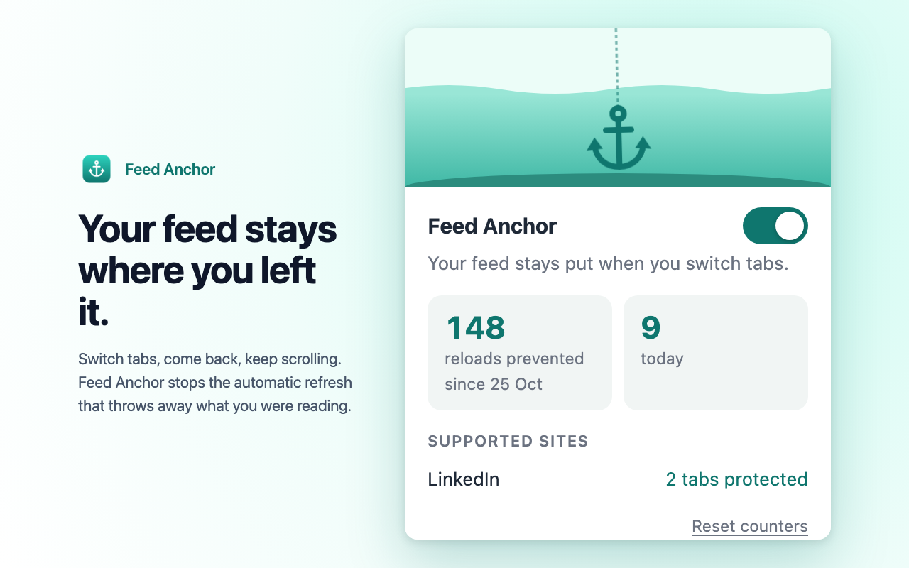

<p align="center">
  
</p>

<h1 align="center">Feed Anchor</h1>

<p align="center">Your feed stays where you left it.<br>
A Chrome extension that stops social feeds from auto-refreshing when you switch back to the tab.</p>

<p align="center"></p>

## Why

Some sites reload the feed whenever you return to the tab. If you were halfway through a post, or kept a tab open to read later, it's gone. Feed Anchor makes the page think you never left, so nothing triggers the refresh.

## Supported sites

| Site | Status |
| --- | --- |
| LinkedIn | ✅ Supported |

More platforms are planned. See [CONTRIBUTING.md](CONTRIBUTING.md) to add one.

## Install

**Chrome Web Store:** _link coming soon_

**From source:**
1. Clone this repo.
2. Open `chrome://extensions` and turn on **Developer mode**.
3. Click **Load unpacked** and select the `src/` folder.

## How it works

Sites usually refresh on return by listening for the [Page Visibility API](https://developer.mozilla.org/docs/Web/API/Page_Visibility_API) and window focus events. On supported sites Feed Anchor:

1. **Reports the tab as always visible and focused.** `inject.js` runs in the page's own context at `document_start` and overrides `document.hidden`, `document.visibilityState` and `document.hasFocus()`.
2. **Stops the events.** It catches `visibilitychange` and window-level `focus`/`blur` events before the site's listeners see them. Focus events on inputs and other elements are left alone.
3. **Keeps the tab loaded.** It marks supported tabs as not auto-discardable, so Chrome's Memory Saver doesn't unload them in the background.

When you come back to the tab, `inject.js` counts it as a prevented reload. `bridge.js` forwards that to the background worker, which keeps the counters and badge.

The popup switch turns all of this off and on live. When it's off, the page sees the real visibility and focus values again and tabs can be discarded normally.

```
src/
  manifest.json   Manifest V3
  sites.js        list of supported sites
  inject.js       page-context script (visibility/focus overrides)
  bridge.js       passes the on/off setting in and events out
  background.js   counters, badge, Memory Saver protection
  popup.html/js   the popup UI
```

## Privacy

There is no data collection, network requests, analytics or remote code. The on/off setting and the counters stay in local extension storage. See [PRIVACY.md](PRIVACY.md).

## Permissions

| Permission | Why |
| --- | --- |
| `storage` | Saves the on/off setting and counters on your device. |
| Access to supported sites (`linkedin.com`) | Runs the scripts above and keeps those tabs from being discarded. |

## Development

```sh
scripts/package.sh            # build dist/feed-anchor-<version>.zip for the store
scripts/build-icons.sh        # regenerate src/icons from assets/*.svg
scripts/build-store-assets.sh # regenerate store screenshots and promo tile
```

The scripts need macOS or Linux with Google Chrome (used headless to render images), `zip` and `jq`.

## License

[MIT](LICENSE)

---

Feed Anchor is an independent project. It is not affiliated with, endorsed by or sponsored by LinkedIn Corporation. LinkedIn is a trademark of LinkedIn Corporation.
